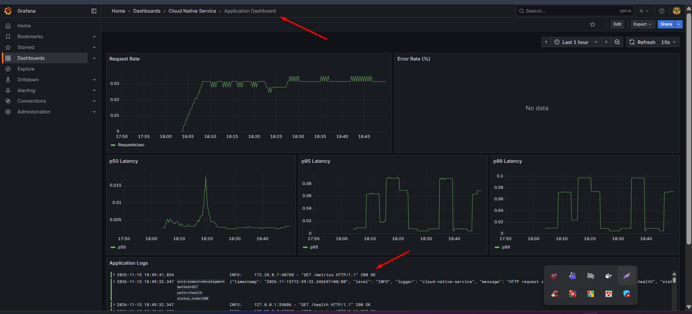
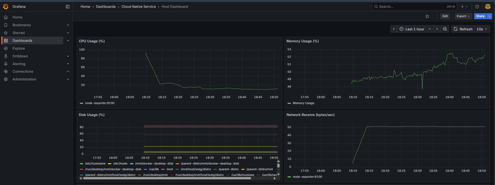
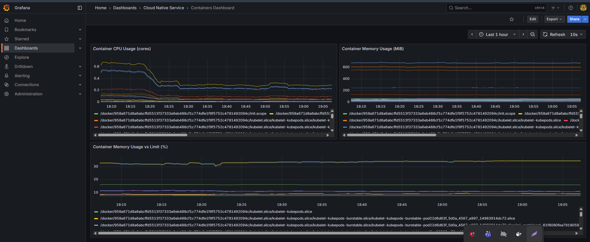

# Cloud Native Service

A production-oriented Python FastAPI application built as part of a DevOps Engineer technical assessment. This project demonstrates application development, containerization, CI/CD automation, Infrastructure as Code, Kubernetes deployment, and observability practices.

**Project Status:** Step 1 – Completed | Step 2 – In Progress | Step 3 – Completed | Step 4 – Completed | Step 5 – Completed | Step 6 – In Progress

---

## Project Overview

Cloud Native Service is a lightweight REST API designed to demonstrate an end-to-end DevOps workflow, from application development and containerization to automated deployment and infrastructure management.

The project focuses on:

- Production-oriented application development
- Secure Docker image construction
- Automated testing and CI/CD
- AWS infrastructure provisioning using Terraform
- Kubernetes orchestration
- Metrics, logging, and monitoring
- Linux automation and operational practices

## Technology Stack

| Category | Technology |
|---|---|
| Language | Python 3.14.3 |
| Framework | FastAPI |
| API Server | Uvicorn |
| Metrics | Prometheus Client |
| Testing | Pytest |
| Containerization | Docker |
| Local Orchestration | Docker Compose |
| CI/CD | GitHub Actions (planned/in progress) |
| Infrastructure as Code | Terraform |
| Cloud Provider | AWS |
| Infrastructure Monitoring | CloudWatch |
| Remote State | Amazon S3 |
| Orchestration | Kubernetes (planned/in progress) |
| Version Control | Git & GitHub |

## Project Structure

```text
cloud-native-service/
│
├── app/
│   ├── __init__.py
│   ├── main.py
│   ├── config.py
│   └── logging_config.py
│
├── tests/
│   └── test_app.py
│
├── terraform/
│   ├── environments/
│   │   ├── staging.tfvars
│   │   └── production.tfvars
│   ├── main.tf
│   ├── backend.tf
│   ├── variables.tf
│   ├── outputs.tf
│   ├── vpc.tf
│   ├── ec2.tf
│   ├── iam.tf
│   ├── security.tf
│   ├── cloudwatch.tf
│   └── bootstrap.sh
│
├── docs/
│   └── screenshots/
│
├── .github/
│   └── workflows/
│
├── Dockerfile
├── docker-compose.yml
├── .dockerignore
├── .gitignore
├── requirements.txt
├── requirements-dev.txt
└── README.md
```

---

## Application & API

The application is developed using Python and FastAPI.

### API Endpoints

| Method | Endpoint | Description |
|---|---|---|
| GET | `/` | Application information |
| GET | `/health` | Application health check |
| GET | `/metrics` | Prometheus-compatible metrics |

### Root Response

```json
{
  "message": "Hello from DevOps Task!",
  "status": "running",
  "version": "1.0.0"
}
```

### Health Response

```json
{
  "status": "healthy",
  "environment": "development"
}
```

### API Documentation

FastAPI Swagger UI:

`http://localhost:8000/docs`

---

## Local Development

### Prerequisites

- Python 3.14.3
- Git
- Docker Desktop

### Clone Repository

```bash
git clone https://github.com/tahsinulhoque/cloud-native-service.git

cd cloud-native-service
```

### Create Virtual Environment

Windows PowerShell:

```powershell
py -3.14 -m venv .venv

.\.venv\Scripts\Activate.ps1
```

### Install Dependencies

```powershell
python -m pip install -r requirements-dev.txt
```

### Run Application

```powershell
python -m uvicorn app.main:app --reload --port 8000
```

Application:

`http://localhost:8000`

## Testing

Run unit tests:

```powershell
python -m pytest -v
```

Current test coverage includes:

- Root endpoint
- Health endpoint
- Prometheus metrics endpoint

**Latest verified result:** 3 tests passed.

---

## Docker Deployment

### Build Docker Image

```bash
docker build -t cloud-native-service:1.0.0 .
```

### Run Container

```bash
docker run -d \
  --name cloud-native-test \
  -p 8080:8000 \
  cloud-native-service:1.0.0
```

### Docker Compose

Start services:

```bash
docker compose up --build -d
```

Check container status:

```bash
docker compose ps
```

View application logs:

```bash
docker compose logs -f app
```

Stop services:

```bash
docker compose down
```

### Container Security

The Docker configuration implements:

- Multi-stage image build
- Version-pinned Python base image
- Non-root application execution
- Docker HEALTHCHECK
- OCI image labels
- Resource limits through Docker Compose

### Image Size

Latest local Docker build measurement:

| Measurement | Result |
|---|---:|
| Docker content size | 50.3 MB |
| Docker disk usage | 207 MB |

These represent different Docker-reported measurements.

---

# Infrastructure as Code – Terraform (AWS)

**Status: Completed and tested**

Terraform is used to provision and manage the AWS infrastructure required to deploy the application.

The same Terraform configuration supports separate staging and production environments through variable files and Terraform workspaces.

## Architecture Overview

```text
                    Terraform
                        |
                        v
                 AWS Infrastructure
                        |
          +-------------+-------------+
          |                           |
          v                           v
       Custom VPC                 IAM Role
          |                           |
          v                           v
    Public Subnet              Instance Profile
          |
          v
      EC2 Instance
          |
          v
    Docker Installation
          |
          v
   Application Container
          |
          v
      HTTP :80
          |
          v
      /health

Application Container Logs
          |
          v
    CloudWatch Logs
          |
          v
   7-Day Log Retention

Terraform State
          |
          v
    Amazon S3 Backend
          |
          v
       State Locking
```

## AWS Infrastructure Components

| Component | Configuration |
|---|---|
| AWS Region | us-west-2 (Oregon) |
| VPC | Custom VPC |
| VPC CIDR | 10.20.0.0/16 |
| Public Subnet | 10.20.1.0/24 |
| EC2 Instance | t3.micro |
| Operating System | Ubuntu 24.04 LTS |
| Security Group | HTTP and restricted SSH |
| IAM | EC2 Role and Instance Profile |
| Application Runtime | Docker |
| Container Registry | Docker Hub |
| Logging | Amazon CloudWatch Logs |
| Log Retention | 7 days |
| Terraform Backend | Amazon S3 |
| State Locking | S3 Lockfile |

## 1. Networking and Security

Terraform provisions:

- A custom VPC.
- A public subnet.
- An Internet Gateway.
- A public route table and subnet association.
- An EC2 security group.

Security group ingress rules:

| Port | Protocol | Access |
|---|---|---|
| 80 | TCP | Public HTTP traffic |
| 22 | TCP | Restricted trusted IP (/32) |

Outbound traffic is allowed for required application and infrastructure operations.

## 2. EC2 and Application Bootstrap

The EC2 instance is provisioned using Terraform.

A bootstrap script (`bootstrap.sh`) automatically:

1. Updates the Ubuntu package index.
2. Installs Docker.
3. Enables and starts Docker.
4. Pulls the application image from Docker Hub.
5. Starts the application container.
6. Configures the container environment.
7. Sends container logs to CloudWatch Logs.

The application container is exposed through port 80 on the EC2 instance.

The application environment is passed through Terraform variables rather than being hardcoded in the bootstrap configuration.

## 3. IAM Security

An EC2 IAM Role and Instance Profile are provisioned.

Permissions include:

- AmazonSSMManagedInstanceCore for Systems Manager access.
- A custom CloudWatch Logs policy for creating log streams and publishing log events.

No static AWS access keys are configured on the EC2 instance.

## 4. CloudWatch Logging

Application container logs are shipped directly to Amazon CloudWatch Logs using the Docker `awslogs` logging driver.

| Setting | Value |
|---|---|
| Log Group – Staging | `/cloud-native-service/staging` |
| Log Group – Production | `/cloud-native-service/production` |
| Log Driver | awslogs |
| Log Retention | 7 days |

CloudWatch logging was verified using application health-check requests and log events.

## 5. Remote Terraform State

Terraform state is stored remotely in Amazon S3.

| Setting | Configuration |
|---|---|
| Backend | S3 |
| Bucket | `cloud-native-service-tfstate` |
| Region | us-west-2 |
| Encryption | Enabled |
| State Locking | `use_lockfile = true` |
| Workspace Prefix | `cloud-native-service` |

Separate Terraform workspaces are used:

- `staging`
- `production`

This keeps the two environments' Terraform states separate.

The S3 backend bucket is retained after infrastructure testing so the remote state backend remains available.

## 6. Environment Configuration

The same Terraform code supports both environments.

### Staging

`terraform/environments/staging.tfvars`

```hcl
aws_region       = "us-west-2"
environment      = "staging"
instance_type    = "t3.micro"
ssh_allowed_cidr = "YOUR_TRUSTED_IP/32"
```

### Production

`terraform/environments/production.tfvars`

```hcl
aws_region       = "us-west-2"
environment      = "production"
instance_type    = "t3.micro"
ssh_allowed_cidr = "YOUR_TRUSTED_IP/32"
```

Replace `YOUR_TRUSTED_IP` with the appropriate trusted IP address before deployment.

## 7. Terraform Commands

Initialize Terraform:

```powershell
terraform init
```

Check available workspaces:

```powershell
terraform workspace list
```

Select staging:

```powershell
terraform workspace select staging
```

Create staging plan:

```powershell
terraform plan -var-file="environments/staging.tfvars" -out="staging.tfplan"
```

Apply staging configuration:

```powershell
terraform apply "staging.tfplan"
```

Select production:

```powershell
terraform workspace select production
```

Create production plan:

```powershell
terraform plan -var-file="environments/production.tfvars" -out="production.tfplan"
```

Apply production only when an actual production deployment is intended:

```powershell
terraform apply "production.tfplan"
```

Destroy staging infrastructure after testing:

```powershell
terraform workspace select staging

terraform destroy -var-file="environments/staging.tfvars"
```

**Note:** Production infrastructure was planned and validated but was not applied during this assessment. Staging infrastructure was successfully deployed, tested, and destroyed.

## 8. Terraform Verification Results

| Verification | Result |
|---|---|
| Staging Terraform Plan | Successful |
| Staging Terraform Apply | Successful |
| EC2 Deployment | Successful |
| Application Health Check | Healthy |
| Environment Configuration | staging |
| CloudWatch Log Delivery | Verified |
| CloudWatch Retention | 7 days |
| Production Terraform Plan | Successful |
| Production Plan – Resources | 12 to add, 0 to change, 0 to destroy |
| Staging Cleanup | 12 resources destroyed |
| Staging Workspace State | Empty |
| Production Workspace State | Empty |

Both environments use separate Terraform workspaces. The production plan was generated successfully without applying production infrastructure.

## 9. Terraform Evidence

Screenshots are maintained in `docs/screenshots/`.

| Evidence | Screenshot |
|---|---|
| Staging Terraform Plan | `01-staging-plan.png` |
| Staging Terraform Apply | `02-staging-apply.png` |
| Application Health Check | `03-application-health.png` |
| CloudWatch Log Stream | `04-cloudwatch-log-stream.png` |
| CloudWatch Log Events | `05-cloudwatch-log-events.png` |
| CloudWatch Retention | `06-cloudwatch-retention.png` |
| Production Terraform Plan | `07-production-plan.png` |
| Staging Terraform Destroy | `08-staging-destroy.png` |

---

## CI/CD Pipeline – GitHub Actions

**Status: In Progress**

Planned workflow:

- Pull request validation
- Python linting and unit testing
- Test coverage reporting
- Dockerfile linting with Hadolint
- Shell script linting with ShellCheck
- Trivy vulnerability scanning
- Multi-architecture Docker image builds
- SHA and semantic version tagging
- Container registry publishing
- EC2 deployment
- Health-check smoke testing
- Automatic rollback on deployment failure

The deployment workflow will use secure authentication and avoid hardcoded secrets.

---

## Kubernetes Deployment

**Status: Implemented and Tested**

The application is deployed to a local Kubernetes cluster using Kind.

### Kubernetes Components

| Component | Configuration |
|---|---|
| Cluster | Kind |
| Deployment | cloud-native-service |
| Replicas | 2 |
| Update Strategy | RollingUpdate |
| Max Surge | 1 |
| Max Unavailable | 0 |
| Service | ClusterIP |
| Application Port | 8000 |
| HPA | CPU-based |
| Minimum Replicas | 2 |
| Maximum Replicas | 5 |
| CPU Target | 70% |

### Kubernetes Manifests

All application manifests are maintained under `k8s/`.

- `deployment.yaml` — Application Deployment, probes, resources and security context.
- `service.yaml` — Internal ClusterIP Service.
- `configmap.yaml` — Application environment configuration.
- `secret.yaml` — Kubernetes Secret resource.
- `hpa.yaml` — CPU-based Horizontal Pod Autoscaler.

### Security Configuration

The application container runs with:

- Non-root user (UID 999).
- `allowPrivilegeEscalation: false`.
- `readOnlyRootFilesystem: true`.
- CPU and memory requests and limits.

### Configuration and Secrets

Application configuration is provided through a ConfigMap.

The application currently has no sensitive environment variables that require a Secret. The Secret manifest does not contain credentials or sensitive values.

For future sensitive configuration, create Kubernetes Secrets at deployment time using an external secret manager or a secure local environment/file. Do not commit plaintext credentials to Git.

### Deploy to Kind

Create the local cluster:

```powershell
kind create cluster --name cloud-native-service
```

Apply Kubernetes manifests:

```powershell
kubectl apply -f .\k8s\
```

Check deployment:

```powershell
kubectl get deployments
kubectl get pods
kubectl get services
kubectl get hpa
```

### Access the Application

A port-forward alternative is used instead of an Ingress:

```powershell
kubectl port-forward service/cloud-native-service 8080:8000
```

Test the endpoints from another terminal:

```powershell
Invoke-RestMethod http://localhost:8080/
Invoke-RestMethod http://localhost:8080/health
```

### Horizontal Pod Autoscaling

The HPA scales the application based on CPU utilization.

```powershell
kubectl top nodes
kubectl top pods
kubectl get hpa
```

The local Kind cluster uses Metrics Server to provide resource metrics.

### Rolling Update

A new application image was built and pushed to Docker Hub:

```powershell
docker build -t tahsinuldev/cloud-native-service:1.0.4 .
docker push tahsinuldev/cloud-native-service:1.0.4
```

Update the Kubernetes Deployment:

```powershell
kubectl set image deployment/cloud-native-service cloud-native-service=tahsinuldev/cloud-native-service:1.0.4
```

Monitor the rollout:

```powershell
kubectl rollout status deployment/cloud-native-service
kubectl get pods -l app=cloud-native-service
```

The rolling update completed successfully with two Ready replicas.

### Rollback

Rollback to the previous Deployment revision:

```powershell
kubectl rollout undo deployment/cloud-native-service
```

Verify the rollback:

```powershell
kubectl rollout status deployment/cloud-native-service
kubectl get deployment cloud-native-service -o jsonpath="{.spec.template.spec.containers[0].image}"
kubectl get pods -l app=cloud-native-service
```

**Verified rollback result:** The Deployment returned to image `tahsinuldev/cloud-native-service:1.0.3`, with two Running and Ready pods.

### Production Considerations for Amazon EKS

For a production EKS deployment:

- Use an AWS Load Balancer Controller or another supported Ingress controller.
- Integrate AWS Secrets Manager or another managed secrets solution.
- Configure node autoscaling using Karpenter or Cluster Autoscaler.
- Use IAM Roles for Service Accounts (IRSA) or EKS Pod Identity for AWS permissions.
- Configure production monitoring, logging, network policies and access controls.

### Kubernetes Evidence

Screenshots are maintained in `docs/screenshots/kubernetes/`.


## Observability Stack

**Status: Implemented and Tested**

The local observability stack uses Docker Compose and includes all six required components.

| Component | Purpose |
|---|---|
| Prometheus | Application, host and container metrics collection |
| Grafana | Dashboards and visualization |
| Loki | Centralized log aggregation |
| Grafana Alloy | Docker log discovery, parsing and forwarding |
| Node Exporter | Host-level metrics |
| cAdvisor | Container-level metrics |

### 1. Start the Observability Stack

Create the environment file:

```powershell
Copy-Item .env.example .env
```

Set a strong Grafana admin password in `.env`.

Start the application and monitoring services:

```powershell
docker compose -f docker-compose.yml -f docker-compose.monitoring.yml up -d
```

Check service status:

```powershell
docker compose -f docker-compose.yml -f docker-compose.monitoring.yml ps
```

Access Grafana:

`http://127.0.0.1:3000`

Use the Grafana admin credentials configured in `.env`.

Stop the stack:

```powershell
docker compose -f docker-compose.yml -f docker-compose.monitoring.yml down
```

### 2. Metrics Collection

Prometheus scrapes metrics from three targets:

| Target | Metrics |
|---|---|
| Application (`app:8000/metrics`) | Request count, error count and latency |
| Node Exporter (`node-exporter:9100`) | Host CPU, memory, disk and network |
| cAdvisor (`cadvisor:8080`) | Container CPU and memory |

Prometheus configuration is maintained in:

`monitoring/prometheus/prometheus.yml`

Prometheus data retention is explicitly configured to **15 days**.

### 3. Log Collection

Grafana Alloy discovers Docker containers and collects their logs through Docker service discovery. It forwards the logs to Loki.

The Alloy configuration parses structured JSON application logs.

To keep label cardinality low:

- `level` is stored as a Loki label.
- `path`, `method`, `status_code` and `environment` are stored as structured metadata.

This allows log filtering without creating high-cardinality labels.

Loki retention is configured to **168 hours (7 days)**.

Configuration files:

- `monitoring/alloy/config.alloy`
- `monitoring/loki/loki-config.yml`

### 4. Grafana Dashboards

Grafana data sources and dashboards are provisioned from repository configuration files.

Provisioning directories:

- `monitoring/grafana/provisioning/datasources/`
- `monitoring/grafana/provisioning/dashboards/`

Dashboard JSON files:

- `monitoring/grafana/dashboards/application.json`
- `monitoring/grafana/dashboards/host.json`
- `monitoring/grafana/dashboards/containers.json`

#### Application Dashboard

Displays request rate, error rate, p50/p95/p99 latency and application logs from Loki.



#### Host Dashboard

Displays host CPU, memory, disk and network usage using Node Exporter.



#### Containers Dashboard

Displays per-container CPU usage, memory usage and memory usage relative to configured limits using cAdvisor.



### 5. Alerting Rules

Four Prometheus alert rules are configured in:

`monitoring/prometheus/alerts.yml`

| Alert | Condition | For | Reason |
|---|---|---|---|
| ApplicationDown | Application target is down | 1 minute | Avoids alerts for brief scrape interruptions |
| HighErrorRate | Error rate exceeds 5% | 2 minutes | Detects sustained application errors rather than short spikes |
| HostDiskUsageHigh | Disk usage exceeds 80% | 5 minutes | Provides time to investigate before disk capacity becomes critical |
| ContainerMemoryNearLimit | Container memory exceeds 90% of its limit | 2 minutes | Warns before the container reaches its memory limit |

### 6. Host Resource Access

Node Exporter and cAdvisor require access to host-level resources to collect system and container metrics.

**Node Exporter mounts:**

- `/:/host:ro` — read-only host filesystem access for host metrics.

**cAdvisor mounts and privileges:**

- `/:/rootfs:ro` — host root filesystem visibility.
- `/var/run:/var/run:ro` — runtime information.
- `/sys:/sys:ro` — kernel and cgroup metrics.
- `/var/lib/docker:/var/lib/docker:ro` — Docker container metadata.
- `/dev/disk:/dev/disk:ro` — disk device information.
- `/dev/kmsg` — kernel message access.
- `privileged: true` — access required for container and host resource monitoring.

The filesystem mounts are read-only to limit modification of host resources.

### 7. Network and Security

- Grafana is the only monitoring component exposed to the host, bound to `127.0.0.1:3000`.
- Prometheus, Loki, Alloy, Node Exporter and cAdvisor communicate through the internal Docker network.
- Grafana admin credentials are provided through environment variables.
- `.env` is excluded from Git; `.env.example` documents the required variables.
- All monitoring container images use pinned versions.

### 8. Investigating an Application Error Spike

When an error spike appears on the Application Dashboard:

1. Check the error rate and request rate panels to identify when the spike started.
2. Compare the p50, p95 and p99 latency panels to determine whether response times increased.
3. Use the Loki logs panel beside the application metrics to inspect application errors around the same time.
4. Filter logs by the `level` label and inspect structured metadata such as `path`, `method` and `status_code`.
5. Identify the affected endpoint and HTTP status code.
6. Correlate the errors with request rate and latency to narrow down the likely application issue.

This workflow uses Prometheus metrics and Loki logs together in Grafana to investigate application errors.

---

## Linux Automation

**Status: Planned / In Progress**

The `system_health.sh` script will provide:

- CPU utilization
- Memory utilization
- Disk usage
- Load average
- Top five memory-consuming processes
- JSON output
- Configurable warning thresholds
- Timestamped health logs
- Log rotation
- Meaningful exit codes
- Cron or systemd scheduling

---

## Architecture – End-to-End Workflow

The overall assessment architecture:

```text
Developer
    |
    v
GitHub Repository
    |
    v
GitHub Actions
    |
    +-- Linting
    +-- Unit Testing
    +-- Coverage
    +-- Security Scanning
    |
    v
Container Registry
    |
    v
AWS EC2 Deployment
    |
    v
Docker Application
    |
    +-- Health Check
    +-- CloudWatch Logs


Separate Kubernetes Deployment:
Application Image
    |
    v
Local Kubernetes Cluster
    |
    v
Deployment / Service / HPA


Observability:
Application + Host + Containers
              |
              v
       Prometheus / Alloy
              |
        +-----+-----+
        |           |
        v           v
     Metrics       Loki
        |           |
        +-----+-----+
              |
              v
            Grafana
```

---

## Design Decisions

- **FastAPI:** Selected for lightweight API development and automatic API documentation.
- **Multi-stage Docker build:** Separates build-time dependencies from the runtime image.
- **Non-root execution:** Reduces container-level privileges.
- **Structured JSON logging:** Makes application logs easier to process and analyze.
- **Prometheus metrics:** Provides a standard format for application monitoring.
- **Terraform:** Enables repeatable and version-controlled infrastructure provisioning.
- **S3 Remote State:** Provides centralized Terraform state storage with state locking.
- **Separate Workspaces:** Keeps staging and production state isolated.
- **IAM Instance Profile:** Avoids static AWS credentials on EC2.
- **CloudWatch Logs:** Centralizes application logs with a defined retention period.

## Deployment & Rollback Strategy

The intended deployment workflow:

1. Validate code changes through CI.
2. Build and scan the container image.
3. Tag the image using the commit SHA and semantic version.
4. Publish the image to a container registry.
5. Deploy the image to EC2 using SSM or SSH.
6. Run a health-check smoke test.
7. Restore the previous image if deployment fails.

## Security Considerations

The project follows these security practices:

- Non-root container execution
- No hardcoded AWS access keys
- IAM least-privilege permissions
- Restricted SSH access
- Controlled network exposure
- Terraform remote state with locking
- Docker image vulnerability scanning
- Environment-based configuration
- Centralized application logging

## AWS Cost Estimation

The assessment uses AWS resources suitable for a small deployment.

The actual cost depends on:

- AWS region
- EC2 instance runtime
- EBS storage
- Network traffic
- CloudWatch log ingestion and retention
- S3 storage

The staging infrastructure was destroyed after testing. The S3 backend bucket was retained for Terraform state management.

A production monthly cost estimate will be documented separately.

## What I Would Improve With More Time

- Stronger application integration testing
- Automated deployment with rollback
- Infrastructure policy validation
- Production-grade secrets management
- Improved monitoring and alerting
- Infrastructure cost optimization
- Kubernetes production deployment on EKS
- Automated security and compliance checks

## AI Tool Usage

AI tools were used as development assistance for implementation guidance, troubleshooting, documentation, and technical explanations.

All submitted code, configurations, and infrastructure decisions are reviewed and validated by the candidate, who is responsible for understanding the implementation.

---

## Author

**Md. Tahsinul Hoque Siddiki**

GitHub: https://github.com/tahsinulhoque

Project Repository: https://github.com/tahsinulhoque/cloud-native-service
